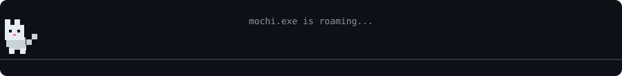

  

  

---

# 👋 About Me

- 💻 **AI & Data Science student** building full-stack and AI-powered projects
- 🚀 Passionate about **building, shipping, and experimenting**
- 🧠 Currently exploring **AI, Web Development & emerging technologies**
- 🛠️ Love turning ideas into real-world products
- 🌐 Interested in **startups, open source, and developer tools**
- ⚡ Fun fact: I probably spend more time coding than sleeping

---

# 💻 Tech Stack

  

---

# 🛠️ Tools & DevOps

  
  
  
  
  
  
  
  
  

---

# 🚀 What I'm Building

- 🤖 AI-powered applications
- 🌐 Full-stack web applications
- 📊 Data Science & Machine Learning projects
- 🧩 Developer tools and experiments
- 🚀 Startup ideas

---

# 📊 GitHub Activity

  

  <a href="https://github.com/beswinjoe?tab=overview">View contribution history</a>
  &nbsp;·&nbsp;
  <a href="https://github.com/beswinjoe?tab=repositories">Explore repositories</a>

